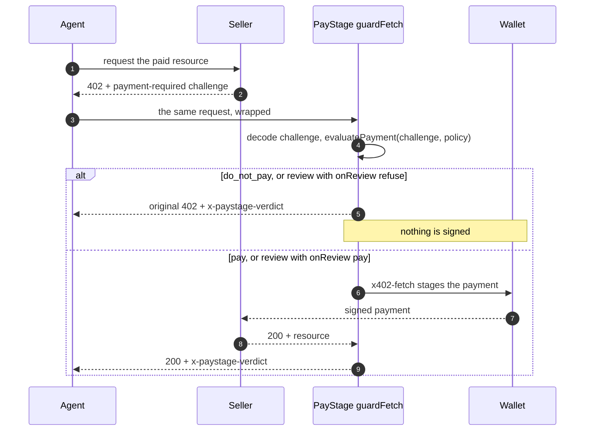
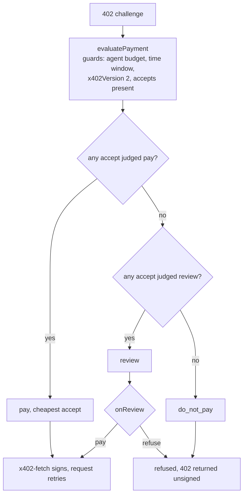

# PayStage

<!--
  Badges, and only badges that cannot lie.

  Each one is produced by the thing it describes, at render time: the npm version by the registry that serves the package, CI by the workflow that runs the tests, the licence
  by LICENSE in this repo, the canary date by the scheduled release run's own successful publish — a shields endpoint reading badges/canary.json on the unprotected `badges`
  branch — and the MCP Registry entry by the registry's own API. Only `x402 · Base` is static, and the badge says so.

  Deliberately absent (#318): stars, downloads, a static "tests passing", coverage unless real, novelty badges. A downloads badge would move when our own CI, mirrors and the
  test harness fetch tarballs — a number that moves when nothing a user cares about moved is not evidence. Every non-static badge's source is listed under
  [Badge sources](#badge-sources).
-->
[](https://www.npmjs.com/package/@paystage/mcp)
[](https://github.com/base-buzz/paystage/actions/workflows/ci.yml)
[](LICENSE)
[](https://github.com/base-buzz/paystage/actions/workflows/release.yml?query=event%3Aschedule)
[](https://registry.modelcontextprotocol.io/v0/servers?search=io.github.base-buzz&from=mcp-registry)
[](#badge-sources)

**Built for agents that spend on your behalf** — Claude Duet, OpenAI Dots, Meta Muse, Grok Bot, and whatever ships next. The
agent is the caller and the payer; the person is the operator who sets the policy. Compatibility is by protocol (MCP and
x402), not by partnership: nothing here implies we are embedded in those products, and the surfaces we are actually in are
graded row by row in [the integration table](docs/integrations/README.md).

The canary date is the day the **scheduled** `release` run last published `@paystage/mcp@canary` — the workflow rewrites `badges/canary.json` after a successful canary publish,
so a missed or failed run leaves the old date standing rather than a fresh-looking one. It links the [scheduled runs](https://github.com/base-buzz/paystage/actions/workflows/release.yml?query=event%3Aschedule)
where that publish happened. Sources for every non-static badge: [Badge sources](#badge-sources).

**Your agent's wallet should not sign because a server asked it to.**

PayStage sits between an agent and the x402 payment it is about to make, and answers one
question before the signature exists: *should this payment happen?* Every tool returns
`pay`, `review`, or `do_not_pay`, with the rule that fired and a receipt you can keep.

The gap it fills is narrow and load-bearing. x402 makes paying trivial and leaves *deciding*
to the caller: a wallet enforces signatures, not intent. `@paystage/x402-guard` evaluates the
challenge before the wallet signs, so a wrong payee, an over-cap amount or an unknown asset
never reaches the signing step at all.

### Where the money does not move

The design point is the arrow that is missing. The wallet *signs* only after the challenge has been
judged; a refusal returns the seller's own 402 with a verdict header attached, so there is nothing to
revoke afterwards.



`review` is reported as `review` either way. When `onReview: "pay"` lets an ambiguous payment
through, the header still says `review`, because the evaluator's finding and the caller's instruction
to tolerate it are different facts — a caller that cannot tell "clean" from "warned but paid" cannot
audit itself. The rule that fires travels in `x-paystage-reason-codes`.

### What decides



`do_not_pay` is a real refusal, not a warning: a payee on the known-drainer or OFAC list, an
over-cap amount, a wrong network or asset, a policy that denies the payee, or a challenge that
cannot be parsed. `review` is the narrow middle — a payee the policy has no opinion about, under a
policy that chose `unknown_payee: "review"` over the stricter default. Both verdicts and the branch
logic are in [packages/preflight/src/evaluate.ts](packages/preflight/src/evaluate.ts); the hook that
uses them is [packages/x402-guard/src/index.ts](packages/x402-guard/src/index.ts).

Try it without installing anything:

```bash
# Copy-paste as-is. A real 12.5 USDC Base challenge against a 5 USDC policy:
curl -s -X POST https://api.paystage.xyz/v1/evaluate_mcp_payment \
  -H 'content-type: application/json' \
  -d '{"payment_required":{"x402Version":2,"resource":{"url":"https://api.dataquay.xyz/v1/ohlc"},"accepts":[{"scheme":"exact","network":"eip155:8453","amount":"12500000","asset":"0x833589fCD6eDb6E08f4c7C32D4f71b54bdA02913","payTo":"0x6160a0d8a3a1f8b0c4e2d1f7b3a9c6e5d4f23757","maxTimeoutSeconds":300}]},"policy":{"version":1,"max_amount":{"value":"5","asset":"USDC","decimals":6},"allowed_pay_to":["0x209693Bc6afc0C5328bA36FaF03C514EF312287C"],"allowed_assets":[{"symbol":"USDC","decimals":6,"address":"0x833589fCD6eDb6E08f4c7C32D4f71b54bdA02913"}],"allowed_networks":["eip155:8453"],"max_timeout_seconds":600,"unknown_payee":"deny"}}'
```

It answers `do_not_pay` with `amount 12.5 USDC exceeds max_amount 5 USDC` — a refusal with a reason, in one paste, with nothing elided. The shorter forms below are for reference
only; an example a reader cannot paste is an example that costs them their first attempt.

The hosted endpoint serves a real verdict with no payment and no account for the first 1,000 calls
a day — an agent cannot fill in a signup form, so requiring one would exclude exactly the callers
this is built for. Beyond that it is **$0.002 per call** over x402, paid in USDC on Base — 1,001 is
0.002, not a plan, not a seat, and no different from the surrounding calls.

Two caveats, both published rather than implied: the free counter lives in Worker isolate memory, so the
allowance is **per instance** and scales with instance count instead of being a global per-IP cap
(`https://api.paystage.xyz/v1/public/status` states it in machine-readable form), and the price is read
from the same constant the Worker charges.

## The ten tools

Nine are read-only. None of them signs, holds a key, or moves money — the agent stays the only signer,
which is the entire product.

The tenth, `request_testnet_funds`, is the one deliberate exception and it is worth naming rather than
hiding: it asks our Base Sepolia faucet for 0.5 test USDC so you can exercise the paid path before
spending anything. It moves testnet funds from a wallet we hold, touches nothing you own, and cannot
reach mainnet.

_All ten are listed with what each answers in [Tools](#tools)._
语言 / Language: **English** · [简体中文](README.zh-CN.md)

## See it work

```bash
npm run build -w @paystage/preflight && node examples/run.mjs
```

Four challenges against one policy, four verdicts with reasons — no network, no keys. See [examples/](examples/).

## Inside a loop, not in front of one

The endpoints that get paid in this ecosystem are cheap, deterministic calls an agent makes in a loop — hashing at 0.001 USDC, embeddings at 0.0005, completions at 0.003. A gate is bought
when it sits *inside* such a loop, so the integration is one line: whatever pays your x402 call, wrap it.

```js
import { guardFetch } from "@paystage/x402-guard";

// Before:  const pay = wrapFetchWithPayment(fetch, account);
// After:   wrap the same fetch, and every 402 it meets is evaluated first.
const pay = guardFetch(fetch, { walletClient: account, policy });
const res = await pay(url, init);
```

`guardFetch` returns a `fetch` of the same shape, so the loop does not change: it evaluates the 402 the caller was about to sign and passes the response through only when the verdict is
`pay`. A refusal costs one call and nothing else. The exact options are in
[packages/x402-guard/README.md](packages/x402-guard/README.md). The paid endpoint is
$0.002 per call, the same order as the calls around it — so the gate is one more line item, not a new procurement.

A refusal costs nothing; a loop that pays a drainer costs every iteration.

## Quick start

```bash
# Option 1: run instantly
npx -y -p @paystage/mcp paystage-mcp

# Option 2: install locally, then use the package bin
npm install @paystage/mcp
npx paystage-mcp
```

The server waits silently for an agent app to connect. That's normal; press Ctrl+C to exit. To try the tools without an app, run `npx @modelcontextprotocol/inspector npx -y -p @paystage/mcp paystage-mcp`.

`@paystage/mcp` is the umbrella MCP server (**10 tools**, including `evaluate_hip3_trade` and `evaluate_velocity`). It exposes the PayStage tools over stdio and reads a local policy file. See [SECURITY.md](SECURITY.md) for exactly what it accesses and why.


## Connect in one command

Copy the line for your client. The remote is Streamable HTTP, so nothing needs installing.

```bash
# Claude Code
claude mcp add --transport http paystage https://api.paystage.xyz/mcp

# Cursor — append to .cursor/mcp.json
{"mcpServers":{"paystage":{"url":"https://api.paystage.xyz/mcp"}}}

# Any MCP client, or just to read the tool schemas without an account
npx -y mcporter list https://api.paystage.xyz/mcp
```

Prefer it local? `npx -y -p @paystage/mcp paystage-mcp` runs the same ten tools over stdio and reads a
policy file from disk.

## How this is built

PayStage is a public good. MIT, no account, no custody, and an evaluator you can read in an afternoon.

**The loop that maintains it is agentic.** A research agent runs on a schedule, reads what changed in the protocol and the market, and
writes proposals; a human decides which become backlog rows; build and test agents implement them, and merged work ships through CI.
Counted from this repository on 2026-11-22: **300 merged pull requests**, **14 published packages**, and **10 MCP tools** — each of those three is derived by a script in CI rather than typed here, which is why they are stated at all.

A seatbelt has to move at the speed of the road. The x402 spec, the facilitator landscape and the sanctioned-address list all change
without asking us, so the jobs that keep this useful — re-reading a spec, re-checking a list, noticing a facilitator that started
rejecting payments — are the jobs agents are best at. The loop runs on a cycle measured in hours; it does not claim to outrun an
exploit, and a 24-hour loop would not be that claim.

**Sustainability, stated as a condition rather than a promise.** The work runs on inference budget and operator time. If paid calls
ever cover the cost, the loop continues on its own; until then it depends on both being available. If neither is, the cycle slows —
written down here because the alternative is implying perpetual motion. The measured numbers behind any cost claim live in
`docs/state/` so the claim can be checked rather than believed.

**On the shoulders of others.** This builds on the work of the people who maintain x402 — the protocol, its facilitators, and the
client SDKs whose interfaces we implement — and on the maintainers of the directories and lists that make tools findable. Where we
implement a spec we try to cite it; where we get something wrong, the issue is open.

## What it does not catch

A gate that claims to stop every bad payment is the thing this project argues against. [LIMITS.md](LIMITS.md)
is the honest boundary — settlements that already happened, payees that look legitimate and do not
deliver, payments made outside the wrapper, and eight more. Read it before you trust the gate with money.

[Every term this project uses](docs/glossary.md) — x402, facilitator, settlement, EIP-3009, HIP-3, CAIP-2 and the rest — is defined in one page.

[State of x402 — issue 1](https://paystage.xyz/state-of-x402): the registry counted, with its method.

## Verdict vocabulary

Three states, and every project in this space picked its own three words. If you run more than one of these
gates, here is the mapping — the semantics line up more closely than the names suggest.

| PayStage | Meaning | Same intent elsewhere |
|---|---|---|
| `pay` | within policy — sign and send | DingDawg `ELIGIBLE` · Black_Wall `GO` · MandatePay `authorize` |
| `review` | a human should look before paying | DingDawg `STEP_UP` · Black_Wall `HOLD` · MandatePay `challenge` |
| `do_not_pay` | refuse — a rule fired, and it is named | DingDawg `DENY` · Black_Wall `STOP` · MandatePay `deny` |

One difference worth knowing: `review` is a **policy instruction**, not an oversight. `onReview: "pay"` treats
it as permission, `"refuse"` treats it as a block — the gate never decides that for you.

[How this compares](docs/compare.md) with the four closest things in this lane — including what each has that we do not.

## Start here if you are paying a seller

[Burn five minutes before your agent pays anything](docs/seller-protection.md) — get the seller's challenge,
write one policy file, ask for a verdict, and keep the receipt. `curl` and `node`, nothing to install.

## Four ways in

| You want | Use |
|---|---|
| the gate inside an agent's payment loop | [`@paystage/x402-guard`](packages/x402-guard) |
| the tools in Claude Desktop or Cursor | [`@paystage/mcp`](packages/mcp) |
| nothing installed at all — connect to a URL | `https://api.paystage.xyz/mcp` (Streamable HTTP, listed in the [MCP Registry](https://registry.modelcontextprotocol.io/v0/servers?search=io.github.base-buzz) as a remote server) |
| a verdict from your own service, hosting included | `POST https://api.paystage.xyz/v1/evaluate_mcp_payment` |
| the evaluator as a library | [`@paystage/preflight`](packages/preflight) |
| the Vercel AI SDK | [`@paystage/ai-sdk`](https://www.npmjs.com/package/@paystage/ai-sdk) — two read-only tools, [docs](https://paystage.xyz/ai-sdk) |


## Listed on

- [x402scan](https://www.x402scan.com/server/71d358eb-0ef8-4d6d-8356-91c5bc237fb0?from=x402scan) — a directory of paid x402 endpoints
- [Official MCP Registry](https://registry.modelcontextprotocol.io/v0/servers?search=io.github.base-buzz&from=mcp-registry)
- [Glama](https://glama.ai/mcp/servers/base-buzz/paystage?from=glama)
- [npm](https://www.npmjs.com/package/@paystage/mcp?from=npm)
- [GitHub](https://github.com/base-buzz/paystage?from=github)
- [mcp.so](https://mcp.so/servers/paystage-6d8a8f?from=mcp.so) — lists an older tool count; the endpoint and npm are authoritative

The `?from=` token on each link names the listing channel; the API records it on the first call and `/lab` reports the counts with unknown as its own row.

## Pairings

- [PayMCP](docs/integrations/paymcp.md) — it prices the seller's tool, this gates the buyer's payment; documented as two examples, no
  dependency either way

## Configure

The same MCP config works for Claude Desktop (`claude_desktop_config.json`) and Cursor (`.cursor/mcp.json`).

### Using npx

```json
{
  "mcpServers": {
    "paystage": {
      "command": "npx",
      "args": ["-y", "@paystage/mcp"],
      "env": {
        "PAYSTAGE_POLICY_PATH": "/absolute/path/to/policy.json",
        "PAYSTAGE_RPC_URL": "https://mainnet.base.org"
      }
    }
  }
}
```

### Using a local npm install

```json
{
  "mcpServers": {
    "paystage": {
      "command": "node",
      "args": ["./node_modules/@paystage/mcp/dist/cli.js"],
      "env": {
        "PAYSTAGE_POLICY_PATH": "/absolute/path/to/policy.json",
        "PAYSTAGE_RPC_URL": "https://mainnet.base.org"
      }
    }
  }
}
```

**The MCP server itself needs no environment variables and starts with an empty environment.** It
answers an MCP handshake and lists its tools with nothing configured — the policy arrives as an
argument on each call, not as a file path. Verified:

```bash
env -i npx -y -p @paystage/mcp paystage-mcp   # completes `initialize`, lists ten tools
```

The two variables below are for the **stdio CLI path**, where a policy file is convenient. They are
optional, and a directory that reads this section as "required configuration" will refuse to start a
server that in fact needs nothing:

- `PAYSTAGE_POLICY_PATH` (optional, CLI only): path to a `policy.json` the CLI reads at startup.
- `PAYSTAGE_RPC_URL` (optional): RPC endpoint used by on-chain checks. Defaults to a public Base RPC.

## Policies

Everything PayStage does is decided by one local policy file. Three complete, annotated
examples are in [`registry/examples/`](registry/examples/) — copy one, change the
addresses and amounts, and point `PAYSTAGE_POLICY_PATH` at it. Each is schema-exact for
[`@paystage/policy`](packages/policy/README.md) and annotated field by field in
[`registry/examples/README.md`](registry/examples/README.md).

- [Reader bot](registry/examples/reader-bot.policy.json) — reads articles and search results; 0.05 USDC per call, unknown payees denied.
- [Trading bot](registry/examples/trading-bot.policy.json) — places HIP-3 orders; per-agent budgets, velocity windows and human review above 10 USDC.
- [Research agent](registry/examples/research-agent.policy.json) — discovers data endpoints; unknown payees go to review, never an unattended pay.

## Tools

<!-- tools:table:start -->
| tool | what it answers |
|---|---|
| `evaluate_mcp_payment` | should this x402 payment be signed? → `pay` · `review` · `do_not_pay` |
| `list_outstanding_auths` | which ERC-20 / Permit2 / EIP-3009 authorisations are still outstanding |
| `evaluate_outstanding_auths` | which of those need attention before the next payment |
| `evaluate_hip3_trade` | should this HIP-3 / trade.xyz order be placed? → `allow` · `review` · `do_not_trade` |
| `evaluate_velocity` | is this spend a burst, a spike, or a runaway cadence |
| `verify_receipt` | is this receipt really ours — and is it about *this* payment, still in date |
| `decode_payment_required` | what does this base64 402 header actually say |
| `validate_policy` | is this policy document valid, and if not which field |
| `request_testnet_funds` | 0.5 Base Sepolia USDC for testing — one drip per address per 24h, with the reset time |
| `evaluate_batch` | the same question for several payments, one verdict each |
<!-- tools:table:end -->

## Packages

Fourteen packages. Only `@paystage/mcp` exposes **ten MCP tools**; the rest are the evaluator, guards for other
frameworks, a policy schema and a skill — hence fourteen packages and ten tools, which are different numbers.

<!-- packages:table:start -->
| Package | Role | Links |
| --- | --- | --- |
| `@paystage/mcp` | umbrella MCP server — start here | [npm](https://www.npmjs.com/package/@paystage/mcp) |
| `@paystage/x402-guard` | policy gate for x402 clients, before the wallet signs | [npm](https://www.npmjs.com/package/@paystage/x402-guard) |
| `@paystage/ai-sdk` | the same gate as Vercel AI SDK tools | [npm](https://www.npmjs.com/package/@paystage/ai-sdk) |
| `@paystage/auth-watch` | outstanding ERC-20 / Permit2 / EIP-3009 authorisations | [npm](https://www.npmjs.com/package/@paystage/auth-watch) |
| `@paystage/channel` | read-only x402 deposit-channel state | [npm](https://www.npmjs.com/package/@paystage/channel) |
| `@paystage/policy` | policy schema and loader | [npm](https://www.npmjs.com/package/@paystage/policy) |
| `@paystage/preflight` | x402 payment preflight (the evaluator) | [npm](https://www.npmjs.com/package/@paystage/preflight) |
| `@paystage/receipt-verify` | verify a signed receipt without the server | [npm](https://www.npmjs.com/package/@paystage/receipt-verify) |
| `@paystage/skill` | agent skill manifest | [npm](https://www.npmjs.com/package/@paystage/skill) |
| `@paystage/trade-preflight` | HIP-3 / trade.xyz order preflight | [npm](https://www.npmjs.com/package/@paystage/trade-preflight) |
| `@paystage/velocity` | rate and spend-pattern checks | [npm](https://www.npmjs.com/package/@paystage/velocity) |
| `@paystage/x-evm` | chain-agnostic EVM helpers | [npm](https://www.npmjs.com/package/@paystage/x-evm) |
<!-- packages:table:end -->

## Verify it yourself

Four claims are checked against **production**, not against the repo — run all of them with one command:

```bash
npm run check:live
```

| check | what it asks the deployed system |
|---|---|
| `check-deployed-sha` | is the site serving the newest deployable commit? |
| `check-mcp-live` | does `/mcp` serve exactly the ten declared tools? |
| `check-receipt-live` | does a real receipt verify — and does an altered one fail? |
| `check-sanctions-live` | does the API refuse a sanctioned payee even when the policy allows it? |

Each exits non-zero on failure, so they belong in a release, not in a badge.

The wider conformance kit checks the published surfaces against reality:

```sh
node apps/hosted/scripts/conformance.mjs
```

It checks the published surfaces against reality — manifest shape, the ten tools
being listed, machine surfaces being genuinely different from each other, health and
timing headers on both networks, the receipt key endpoint, that an unpaid evaluation
is challenge-only, and that malformed input fails closed. Read-only: no payment, no
key, no account. Exit code 1 if anything is off.

It runs daily in CI ([cadence.yml](.github/workflows/cadence.yml)) and the result
history is on the [site](https://paystage.xyz).

A green tick is a claim; the run's JSON is the evidence. Every run uploads the full
JSON as the workflow artefact `conformance-<run id>`, retained for 30 days, and a
one-line summary (timestamp, status, passed/total, run id, run URL) is committed to
[docs/state/conformance.log](docs/state/conformance.log) from that artefact. The
artefact is attached per run on the [cadence workflow page](https://github.com/base-buzz/paystage/actions/workflows/cadence.yml);
because the repo is public but artefact downloads require a GitHub login, that page is
the link to the evidence rather than a direct file URL.

## Supply chain

Socket.dev scores packages on capability, so a payment-safety tool will always carry
flags: it reads a policy file, reads two environment variables and talks to an RPC.
Every package README states exactly what it touches and why, and
[SECURITY.md](SECURITY.md) has the full table. **The umbrella resolves to 11 installed modules**, measured by
`scripts/check-deps-budget.mjs` (which packs each package, installs the tarball in an empty project and counts
`npm ls --all --parseable`) and enforced in CI: a dependency that pushes any package past `deps-budget.json` fails
the build, so a new dependency is a deliberate act rather than a diff nobody reads. The umbrella `@paystage/mcp` is ~16 KB
with no network, no filesystem and no `eval` of its own — the capability lives in the
tools it bundles.

## Links

- Website: https://paystage.xyz
- X: https://x.com/paystage_xyz
- GitHub: https://github.com/base-buzz/paystage
- npm: https://www.npmjs.com/org/paystage
- Machine-readable: https://paystage.xyz/llms.txt

## Development

This is an npm-workspaces monorepo — `package-lock.json` is the lockfile and CI runs `npm ci`.
There is no pnpm workspace and no `lint` script; `npm run typecheck` is the check that exists.

```bash
npm ci
npm run build
npm test
npm run typecheck
```

## Contributing

PayStage is built in the open, outside contributions are welcome.

- **Add a drainer address.** Open a PR adding it to `KNOWN_DRAINERS.md` with a public source link (incident report, explorer label, or security write-up). Unsourced addresses won't be merged.
- **Add an integration example.** LangChain, AgentKit, ElizaOS and others are all welcome.
- **Report a bypass.** If an unsafe payment gets past preflight, open an issue. That's the most valuable contribution there is.

Look for issues labelled `good first issue` to get started.

## Badge sources

Every non-static badge in the row at the top reads its value at render time, from the source linked here: the [`@paystage/mcp` version](https://www.npmjs.com/package/@paystage/mcp) from `registry.npmjs.org`; [CI status](https://github.com/base-buzz/paystage/actions/workflows/ci.yml) from the `ci.yml` run history — the workflow that gates merges; the [licence](LICENSE) from `LICENSE` in this repo; the canary last-published date from [`badges/canary.json`](https://github.com/base-buzz/paystage/blob/badges/badges/canary.json) on the `badges` branch, written only by [the scheduled `release.yml` run](https://github.com/base-buzz/paystage/actions/workflows/release.yml?query=event%3Aschedule) after a successful canary publish; and the MCP Registry entry from [the registry's own API](https://registry.modelcontextprotocol.io/v0/servers?search=io.github.base-buzz). npm provenance is not a badge — it is [an attestation on each published version](https://www.npmjs.com/package/@paystage/mcp) and `scripts/check-provenance.mjs` fails a release when a version carries none. The sixth badge, **`x402 · Base`**, is static: it is a label for what this project is, not a measurement, and it is the only one of the six that cannot change on its own.

## License

MIT
