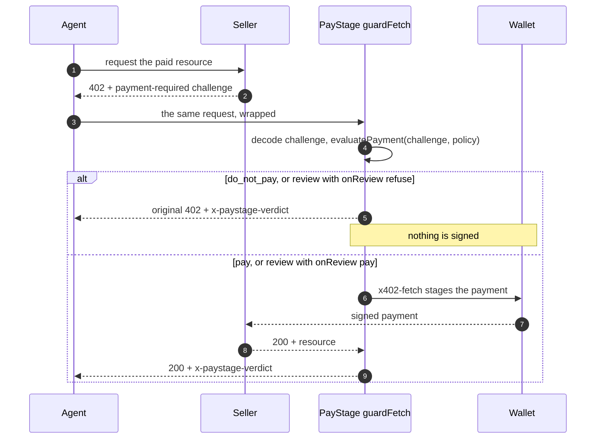
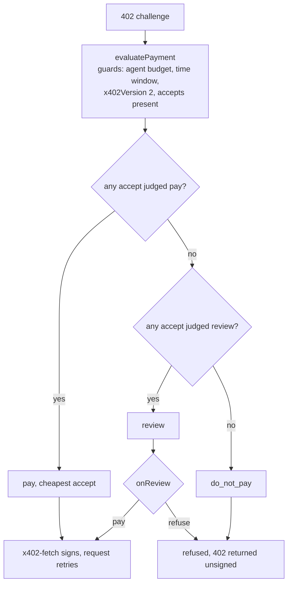

# PayStage

**Your agent's wallet should not sign because a server asked it to.**

PayStage sits between an agent and the x402 payment it is about to make, and answers one
question before the signature exists: *should this payment happen?* Every tool returns
`pay`, `review`, or `do_not_pay`, with the rule that fired and a receipt you can keep.

The gap it fills is narrow and load-bearing. x402 makes paying trivial and leaves *deciding*
to the caller: a wallet enforces signatures, not intent. `@paystage/x402-guard` evaluates the
challenge before the wallet signs, so a wrong payee, an over-cap amount or an unknown asset
never reaches the signing step at all.

### Where the money does not move

The design point is the arrow that is missing. The wallet *signs* only after the challenge has been
judged; a refusal returns the seller's own 402 with a verdict header attached, so there is nothing to
revoke afterwards.



`review` is reported as `review` either way. When `onReview: "pay"` lets an ambiguous payment
through, the header still says `review`, because the evaluator's finding and the caller's instruction
to tolerate it are different facts — a caller that cannot tell "clean" from "warned but paid" cannot
audit itself. The rule that fires travels in `x-paystage-reason-codes`.

### What decides



`do_not_pay` is a real refusal, not a warning: a payee on the known-drainer or OFAC list, an
over-cap amount, a wrong network or asset, a policy that denies the payee, or a challenge that
cannot be parsed. `review` is the narrow middle — a payee the policy has no opinion about, under a
policy that chose `unknown_payee: "review"` over the stricter default. Both verdicts and the branch
logic are in [packages/preflight/src/evaluate.ts](packages/preflight/src/evaluate.ts); the hook that
uses them is [packages/x402-guard/src/index.ts](packages/x402-guard/src/index.ts).

Try it without installing anything:

```bash
curl -s -X POST https://api.paystage.xyz/v1/evaluate_mcp_payment \
  -H 'content-type: application/json' \
  -d '{"payment_required":{…},"policy":{…}}'
```

The hosted endpoint serves a real verdict with no payment and no account for the first 1,000 calls
per IP per day — an agent cannot fill in a signup form, so requiring one would exclude exactly
the callers this is built for.

## The ten tools

Nine are read-only. None of them signs, holds a key, or moves money — the agent stays the only signer,
which is the entire product.

The tenth, `request_testnet_funds`, is the one deliberate exception and it is worth naming rather than
hiding: it asks our Base Sepolia faucet for 0.5 test USDC so you can exercise the paid path before
spending anything. It moves testnet funds from a wallet we hold, touches nothing you own, and cannot
reach mainnet.

_All ten are listed with what each answers in [Tools](#tools)._
语言 / Language: **English** · [简体中文](README.zh-CN.md)

## See it work

```bash
npm run build -w @paystage/preflight && node examples/run.mjs
```

Four challenges against one policy, four verdicts with reasons — no network, no keys. See [examples/](examples/).

## Quick start

```bash
# Option 1: run instantly
npx -y -p @paystage/mcp paystage-mcp

# Option 2: install locally, then use the package bin
npm install @paystage/mcp
npx paystage-mcp
```

The server waits silently for an agent app to connect. That's normal; press Ctrl+C to exit. To try the tools without an app, run `npx @modelcontextprotocol/inspector npx -y -p @paystage/mcp paystage-mcp`.

`@paystage/mcp` is the umbrella MCP server (**10 tools**, including `evaluate_hip3_trade` and `evaluate_velocity`). It exposes the PayStage tools over stdio and reads a local policy file. See [SECURITY.md](SECURITY.md) for exactly what it accesses and why.


## Connect in one command

Copy the line for your client. The remote is Streamable HTTP, so nothing needs installing.

```bash
# Claude Code
claude mcp add --transport http paystage https://api.paystage.xyz/mcp

# Cursor — append to .cursor/mcp.json
{"mcpServers":{"paystage":{"url":"https://api.paystage.xyz/mcp"}}}

# Any MCP client, or just to read the tool schemas without an account
npx -y mcporter list https://api.paystage.xyz/mcp
```

Prefer it local? `npx -y -p @paystage/mcp paystage-mcp` runs the same ten tools over stdio and reads a
policy file from disk.

## What it does not catch

A gate that claims to stop every bad payment is the thing this project argues against. [LIMITS.md](LIMITS.md)
is the honest boundary — settlements that already happened, payees that look legitimate and do not
deliver, payments made outside the wrapper, and eight more. Read it before you trust the gate with money.

[Every term this project uses](docs/glossary.md) — x402, facilitator, settlement, EIP-3009, HIP-3, CAIP-2 and the rest — is defined in one page.

[State of x402 — issue 1](https://paystage.xyz/state-of-x402): the registry counted, with its method.

## Verdict vocabulary

Three states, and every project in this space picked its own three words. If you run more than one of these
gates, here is the mapping — the semantics line up more closely than the names suggest.

| PayStage | Meaning | Same intent elsewhere |
|---|---|---|
| `pay` | within policy — sign and send | DingDawg `ELIGIBLE` · Black_Wall `GO` · MandatePay `authorize` |
| `review` | a human should look before paying | DingDawg `STEP_UP` · Black_Wall `HOLD` · MandatePay `challenge` |
| `do_not_pay` | refuse — a rule fired, and it is named | DingDawg `DENY` · Black_Wall `STOP` · MandatePay `deny` |

One difference worth knowing: `review` is a **policy instruction**, not an oversight. `onReview: "pay"` treats
it as permission, `"refuse"` treats it as a block — the gate never decides that for you.

[How this compares](docs/compare.md) with the four closest things in this lane — including what each has that we do not.

## Start here if you are paying a seller

[Burn five minutes before your agent pays anything](docs/seller-protection.md) — get the seller's challenge,
write one policy file, ask for a verdict, and keep the receipt. `curl` and `node`, nothing to install.

## Four ways in

| You want | Use |
|---|---|
| the gate inside an agent's payment loop | [`@paystage/x402-guard`](packages/x402-guard) |
| the tools in Claude Desktop or Cursor | [`@paystage/mcp`](packages/mcp) |
| nothing installed at all — connect to a URL | `https://api.paystage.xyz/mcp` (Streamable HTTP, listed in the [MCP Registry](https://registry.modelcontextprotocol.io/v0/servers?search=io.github.base-buzz) as a remote server) |
| a verdict from your own service, hosting included | `POST https://api.paystage.xyz/v1/evaluate_mcp_payment` |
| the evaluator as a library | [`@paystage/preflight`](packages/preflight) |
| the Vercel AI SDK | [`@paystage/ai-sdk`](https://www.npmjs.com/package/@paystage/ai-sdk) — two read-only tools, [docs](https://paystage.xyz/ai-sdk) |


## Listed on

- [x402scan](https://www.x402scan.com/server/71d358eb-0ef8-4d6d-8356-91c5bc237fb0) — a directory of paid x402 endpoints
- [Official MCP Registry](https://registry.modelcontextprotocol.io/v0/servers?search=io.github.base-buzz)
- [Glama](https://glama.ai/mcp/servers/base-buzz/paystage)
- [npm](https://www.npmjs.com/package/@paystage/mcp)
- [GitHub](https://github.com/base-buzz/paystage)
- [mcp.so](https://mcp.so/servers/paystage-6d8a8f) — lists an older tool count; the endpoint and npm are authoritative

## Configure

The same MCP config works for Claude Desktop (`claude_desktop_config.json`) and Cursor (`.cursor/mcp.json`).

### Using npx

```json
{
  "mcpServers": {
    "paystage": {
      "command": "npx",
      "args": ["-y", "@paystage/mcp"],
      "env": {
        "PAYSTAGE_POLICY_PATH": "/absolute/path/to/policy.json",
        "PAYSTAGE_RPC_URL": "https://mainnet.base.org"
      }
    }
  }
}
```

### Using a local npm install

```json
{
  "mcpServers": {
    "paystage": {
      "command": "node",
      "args": ["./node_modules/@paystage/mcp/dist/cli.js"],
      "env": {
        "PAYSTAGE_POLICY_PATH": "/absolute/path/to/policy.json",
        "PAYSTAGE_RPC_URL": "https://mainnet.base.org"
      }
    }
  }
}
```

**The MCP server itself needs no environment variables and starts with an empty environment.** It
answers an MCP handshake and lists its tools with nothing configured — the policy arrives as an
argument on each call, not as a file path. Verified:

```bash
env -i npx -y -p @paystage/mcp paystage-mcp   # completes `initialize`, lists ten tools
```

The two variables below are for the **stdio CLI path**, where a policy file is convenient. They are
optional, and a directory that reads this section as "required configuration" will refuse to start a
server that in fact needs nothing:

- `PAYSTAGE_POLICY_PATH` (optional, CLI only): path to a `policy.json` the CLI reads at startup.
- `PAYSTAGE_RPC_URL` (optional): RPC endpoint used by on-chain checks. Defaults to a public Base RPC.

## Policies

Everything PayStage does is decided by one local policy file. Three complete, annotated
examples are in [`registry/examples/`](registry/examples/) — copy one, change the
addresses and amounts, and point `PAYSTAGE_POLICY_PATH` at it. Each is schema-exact for
[`@paystage/policy`](packages/policy/README.md) and annotated field by field in
[`registry/examples/README.md`](registry/examples/README.md).

- [Reader bot](registry/examples/reader-bot.policy.json) — reads articles and search results; 0.05 USDC per call, unknown payees denied.
- [Trading bot](registry/examples/trading-bot.policy.json) — places HIP-3 orders; per-agent budgets, velocity windows and human review above 10 USDC.
- [Research agent](registry/examples/research-agent.policy.json) — discovers data endpoints; unknown payees go to review, never an unattended pay.

## Tools

<!-- tools:table:start -->
| tool | what it answers |
|---|---|
| `evaluate_mcp_payment` | should this x402 payment be signed? → `pay` · `review` · `do_not_pay` |
| `list_outstanding_auths` | which ERC-20 / Permit2 / EIP-3009 authorisations are still outstanding |
| `evaluate_outstanding_auths` | which of those need attention before the next payment |
| `evaluate_hip3_trade` | should this HIP-3 / trade.xyz order be placed? → `allow` · `review` · `do_not_trade` |
| `evaluate_velocity` | is this spend a burst, a spike, or a runaway cadence |
| `verify_receipt` | is this receipt really ours — and is it about *this* payment, still in date |
| `decode_payment_required` | what does this base64 402 header actually say |
| `validate_policy` | is this policy document valid, and if not which field |
| `request_testnet_funds` | 0.5 Base Sepolia USDC for testing — one drip per address per 24h, with the reset time |
| `evaluate_batch` | the same question for several payments, one verdict each |
<!-- tools:table:end -->

## Packages

Ten packages. Only `@paystage/mcp` exposes **ten MCP tools**; the rest are the evaluator, guards for other
frameworks, a policy schema and a skill — hence ten packages and ten tools in the same breath.

<!-- packages:table:start -->
| Package | Role | Links |
| --- | --- | --- |
| `@paystage/mcp` | umbrella MCP server — start here | [npm](https://www.npmjs.com/package/@paystage/mcp) |
| `@paystage/x402-guard` | policy gate for x402 clients, before the wallet signs | [npm](https://www.npmjs.com/package/@paystage/x402-guard) |
| `@paystage/ai-sdk` | the same gate as Vercel AI SDK tools | [npm](https://www.npmjs.com/package/@paystage/ai-sdk) |
| `@paystage/auth-watch` | outstanding ERC-20 / Permit2 / EIP-3009 authorisations | [npm](https://www.npmjs.com/package/@paystage/auth-watch) |
| `@paystage/policy` | policy schema and loader | [npm](https://www.npmjs.com/package/@paystage/policy) |
| `@paystage/preflight` | x402 payment preflight (the evaluator) | [npm](https://www.npmjs.com/package/@paystage/preflight) |
| `@paystage/skill` | agent skill manifest | [npm](https://www.npmjs.com/package/@paystage/skill) |
| `@paystage/trade-preflight` | HIP-3 / trade.xyz order preflight | [npm](https://www.npmjs.com/package/@paystage/trade-preflight) |
| `@paystage/velocity` | rate and spend-pattern checks | [npm](https://www.npmjs.com/package/@paystage/velocity) |
| `@paystage/x-evm` | chain-agnostic EVM helpers | [npm](https://www.npmjs.com/package/@paystage/x-evm) |
<!-- packages:table:end -->

## Verify it yourself

Every claim this project makes about itself is reducible to a command. Run it before
you trust anything on the website:

```sh
node apps/hosted/scripts/conformance.mjs
```

It checks the published surfaces against reality — manifest shape, the ten tools
being listed, machine surfaces being genuinely different from each other, health and
timing headers on both networks, the receipt key endpoint, that an unpaid evaluation
is challenge-only, and that malformed input fails closed. Read-only: no payment, no
key, no account. Exit code 1 if anything is off.

It runs daily in CI ([cadence.yml](.github/workflows/cadence.yml)) and the result
history is on the [site](https://paystage.xyz).

## Supply chain

Socket.dev scores packages on capability, so a payment-safety tool will always carry
flags: it reads a policy file, reads two environment variables and talks to an RPC.
Every package README states exactly what it touches and why, and
[SECURITY.md](SECURITY.md) has the full table. The umbrella `@paystage/mcp` is ~16 KB
with no network, no filesystem and no `eval` of its own — the capability lives in the
tools it bundles.

## Links

- Website: https://paystage.xyz
- X: https://x.com/paystage_xyz
- GitHub: https://github.com/base-buzz/paystage
- npm: https://www.npmjs.com/org/paystage
- Machine-readable: https://paystage.xyz/llms.txt

## Development

This is an npm-workspaces monorepo — `package-lock.json` is the lockfile and CI runs `npm ci`.
There is no pnpm workspace and no `lint` script; `npm run typecheck` is the check that exists.

```bash
npm ci
npm run build
npm test
npm run typecheck
```

## Contributing

PayStage is built in the open, outside contributions are welcome.

- **Add a drainer address.** Open a PR adding it to `KNOWN_DRAINERS.md` with a public source link (incident report, explorer label, or security write-up). Unsourced addresses won't be merged.
- **Add an integration example.** LangChain, AgentKit, ElizaOS and others are all welcome.
- **Report a bypass.** If an unsafe payment gets past preflight, open an issue. That's the most valuable contribution there is.

Look for issues labelled `good first issue` to get started.

## License

MIT
